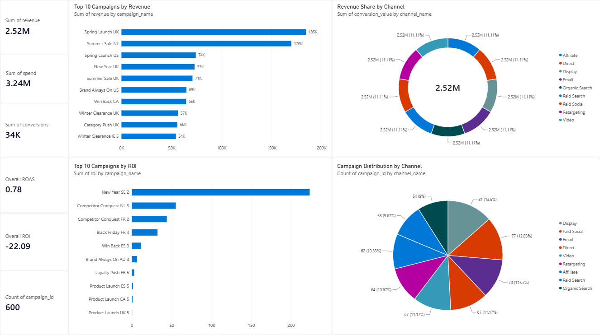
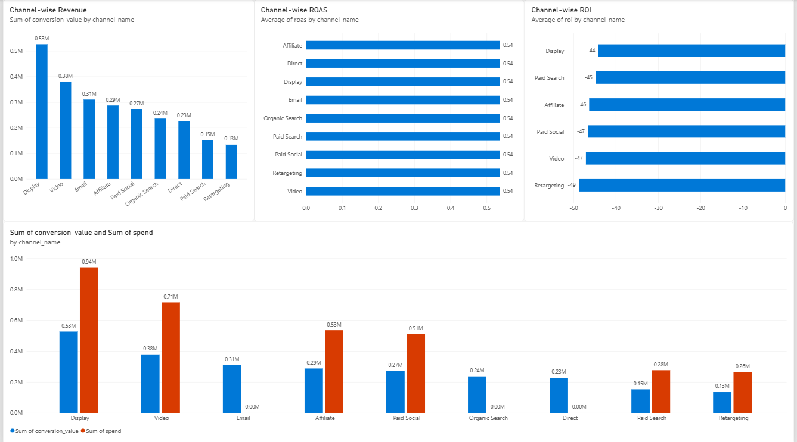
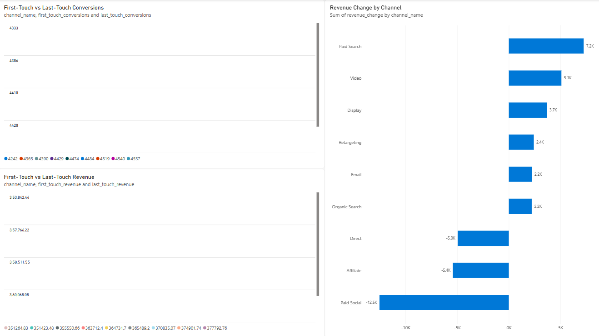
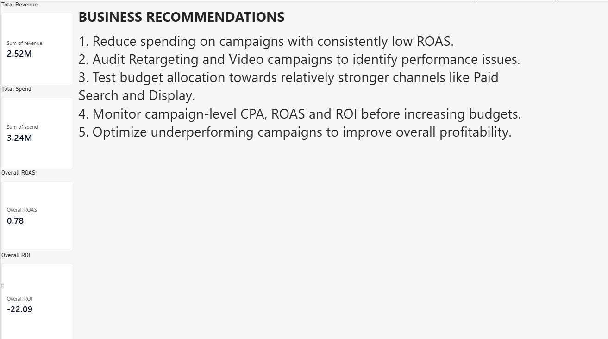

# Marketing Campaign Performance & ROI Optimization

> End-to-end marketing analytics project using Python, SQL, and Power BI to evaluate campaign effectiveness, compare channel performance, investigate attribution, and identify opportunities to improve marketing return.

## Project at a glance

| Area | Details |
|---|---|
| Source tables | 5 |
| Records inspected | 303,609 across source tables |
| Campaigns | 600 |
| Marketing channels | 9 |
| Ad groups | 3,000 |
| Power BI pages | 4 |
| Tools | Python, Pandas, SQL, DuckDB, Power BI |

## Business questions

- Which campaigns generate the highest conversion value and return?
- How do channels compare on spend, conversions, ROAS, and ROI?
- How do first-touch and last-touch attribution views differ?
- Which campaigns and channels require budget review?
- What data-quality or date-coverage limitations affect interpretation?

## Dashboard

[Open the interactive Power BI report](powerbi/Marketing_Campaign_Performance_Dashboard.pbix) with Power BI Desktop.

### Dashboard previews

| Campaign Overview | Channel Analysis |
|---|---|
|  |  |

| Attribution Analysis | Executive Summary |
|---|---|
|  |  |

The report includes headline KPIs, top campaigns by revenue and ROI, channel comparisons, first-touch vs last-touch attribution, executive insights, and optimization recommendations.

## Key results

| KPI | Result |
|---|---:|
| Total Revenue / Conversion Value | 2.52M |
| Total Spend | 3.24M |
| Overall ROAS | 0.78x |
| Overall ROI | -22.09% |
| Campaigns | 600 |

The measured conversion value is below recorded advertising spend in this dataset. The result suggests reviewing paid campaign efficiency before increasing budgets. Zero-spend channels should be evaluated separately rather than ranked by ROAS or ROI.

**Metric caveat:** the dashboard revenue KPI uses the analyzed daily-performance `conversion_value` measure. The conversion-event `revenue` total is a separate measure; date coverage and aggregation differ, so these totals are not forced to reconcile.

## Workflow and methodology

1. Inspect source schemas, row counts, relationships, and date coverage.
2. Validate primary keys, foreign keys, missing values, and data-quality conditions.
3. Analyze campaign and channel performance using SQL/Python exports.
4. Compare first-touch and last-touch attribution.
5. Build the four-page Power BI dashboard and summarize business recommendations.

## Repository structure

```text
.
├── data/           # Data layout guidance; raw/processed local folders
├── docs/           # Data dictionary and metric definitions
├── notebooks/      # Python inspection notebook
├── powerbi/        # Interactive Power BI report
├── reports/        # CSV, Parquet, and Markdown analysis outputs
├── sql/            # SQL analysis and schema definitions
├── visuals/        # Four exported dashboard page previews
├── archive/        # Original project and dashboard asset ZIP archives
├── requirements.txt
└── README.md
```

## Reproducibility

Create a Python environment and install the dependencies:

```bash
python -m venv .venv
pip install -r requirements.txt
jupyter notebook
```

Start with [the data inspection notebook](notebooks/01_data_inspection.ipynb). See the [data dictionary](docs/data_dictionary.md), [analysis reports](reports/README.md), and [SQL documentation](sql/README.md) for details.

## Key findings and recommendations

- Review campaigns with persistently weak ROAS before assigning additional spend.
- Investigate high-spend channels with negative ROI and identify the causes.
- Compare first-touch and last-touch attribution before making channel-level budget decisions.
- Monitor CPA, ROAS, ROI, and conversion quality together.
- Keep zero-spend channels separate when interpreting cost-efficiency metrics.

## Project status

**Analysis and dashboard completed.** The repository contains the inspection notebook, SQL assets, analytical exports, attribution comparisons, data-quality diagnostics, the four-page Power BI report, and all four dashboard previews.

## Author

**Prince Yadav**

[GitHub repository](https://github.com/yprincedec/marketing-campaign-performance-roi-optimization)
